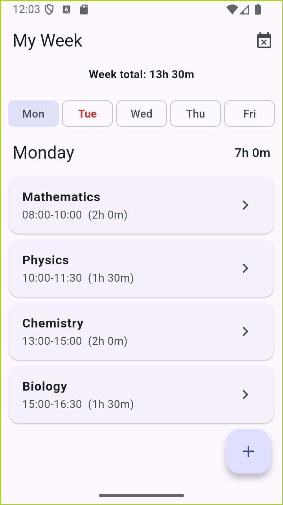
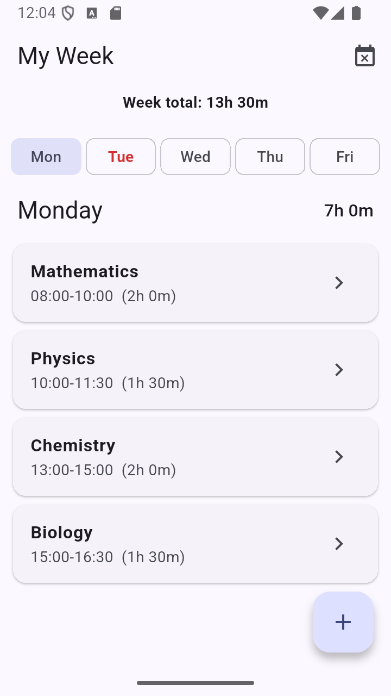
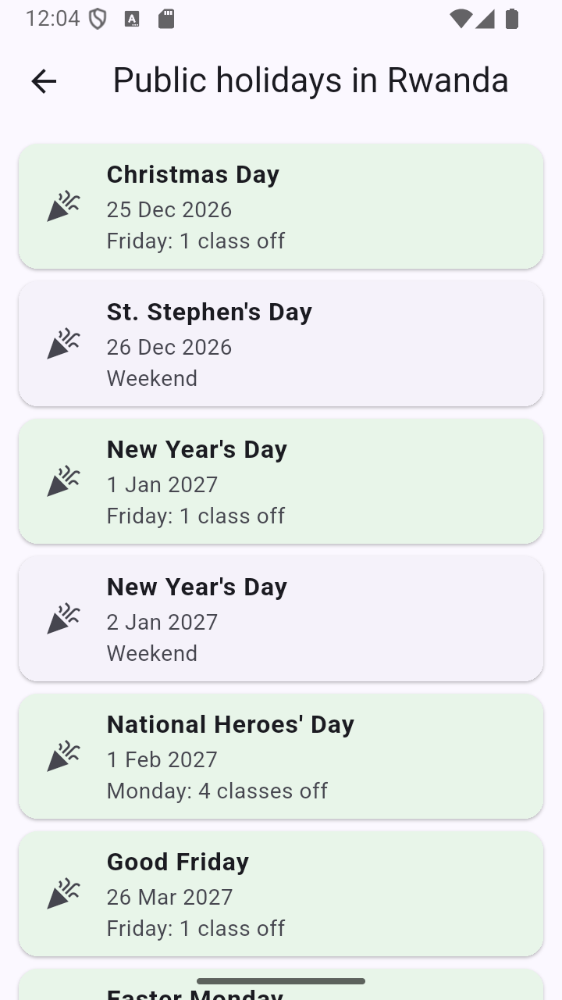
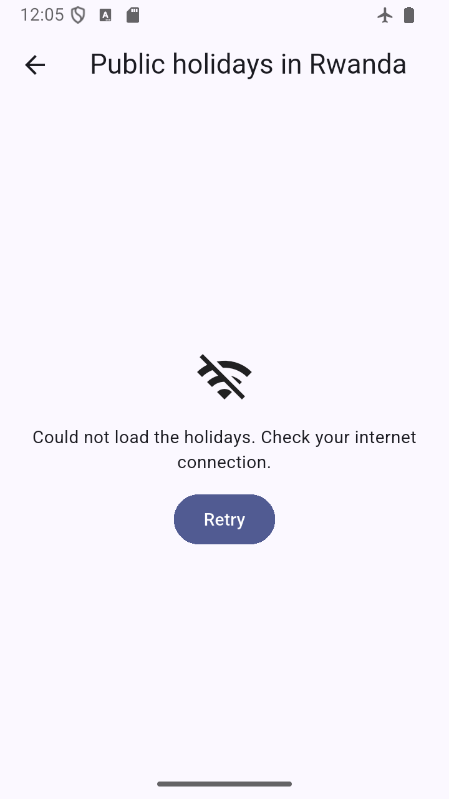

# My Week

My Week is a weekly class timetable: add, edit and delete courses for each weekday, see the hours per day and per week, and spot clashing courses in red. My data is now saved on the phone with shared_preferences,
so nothing is lost when the app closes (every course, with its day and times), and it shows the upcoming public holidays in Rwanda, and how many of my classes fall on each one, from the Nager.Date API.

## Screenshots

